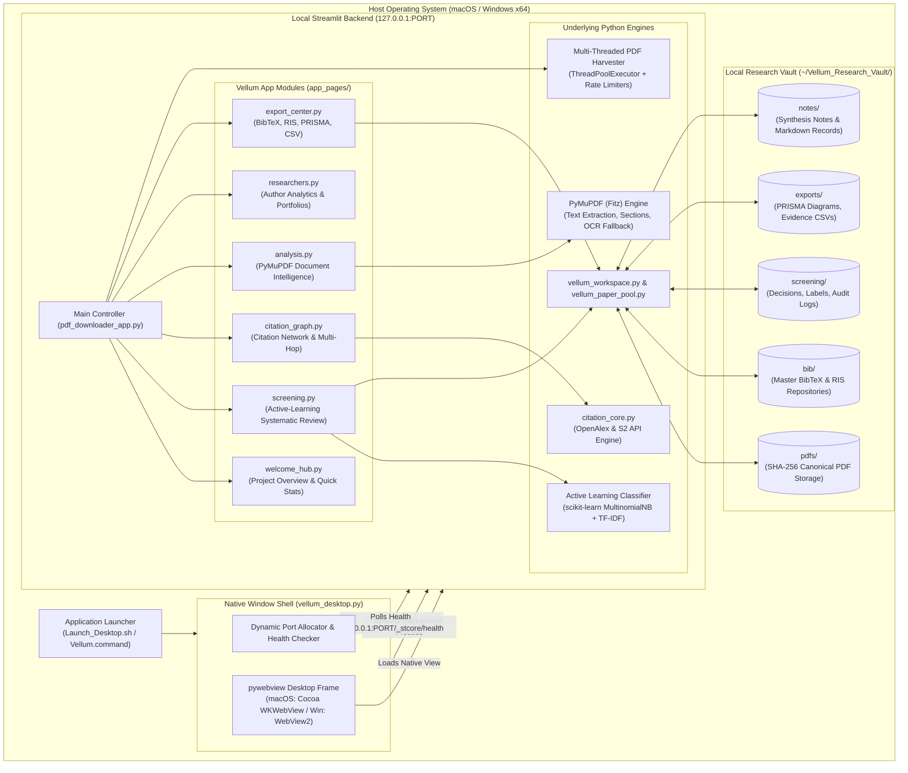
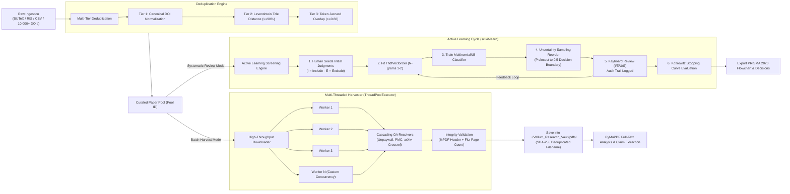
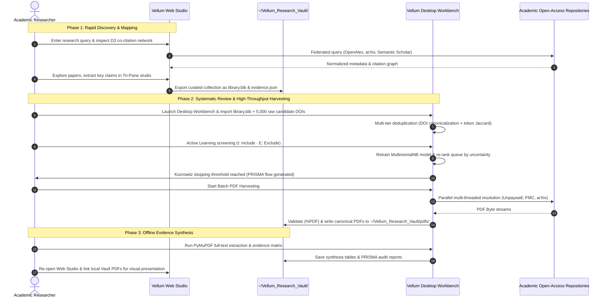

# Vellum Architecture & System Logic Specification

> **Methodology:** Architected using the **Archify** (`tt-a1i/archify`) framework — decomposing complex multi-runtime software into container boundaries, operational data pipelines, state lifecycles, and cross-application bridges.

---

## 1. Tool Selection & Architectural Evaluation

| Evaluation Criteria | **tt-a1i/archify** *(Selected)* | **Graphify-Labs/graphify** | **Egonex-AI/Understand-Anything** |
| :--- | :--- | :--- | :--- |
| **Primary Domain** | **System architecture, runtime dataflow, component boundaries, and state lifecycles.** | AST code parsing and symbol-level knowledge graph extraction. | Multi-agent codebase comprehension and interactive visualization dashboard. |
| **Target Output** | Formal architecture models: C4 Containers, Processing Pipelines, Sequence Traces, and State Transitions. | Symbol call-graphs (function-to-function / file-to-file) with Leiden community detection. | High-level interactive dashboard for file browsing and semantic code search. |
| **Suitability for Vellum** | **Optimal.** Directly models dual web/desktop runtimes, multi-tier resolution cascades, active learning loops, and local-first storage bridges. | Too granular (dumps thousands of AST calls without conveying user/data flows). | Explores codebases interactively but does not generate structured architectural blueprints for documentation. |

---

## 2. Part I: Vellum Web Studio Architecture & Logic Flow

### 2.1 Component & Container Topology

```mermaid
flowchart TD
    subgraph ClientTier["Client Browser Tier (Next.js 16 + React 19)"]
        UI["App Layout & Main Workspace (page.tsx)"]
        
        subgraph UIComponents["Interactive Hub Components"]
            SearchHub["AcademicSearchHub<br/>(Federated Search UI)"]
            GraphHub["ConnectedGraphHub<br/>(D3 Force Citation Network)"]
            TriPane["NotebookWorkspace<br/>(Tri-Pane Evidence Studio)"]
            Radar["TrendingRadar<br/>(Topic Citation Velocity)"]
            Tokens["TokensModal<br/>(API Rate Limit Controls)"]
        end

        subgraph ClientDB["Local Client Persistence (Dexie.js / IndexedDB)"]
            NBStore[("notebooks store<br/>(ID, Title, Category, Metadata)")]
            SrcStore[("sources store<br/>(DOI, Authors, Year, PDF Blob)")]
            NoteStore[("notes store<br/>(Markdown Notes, Timestamps)")]
            EvidStore[("evidence store<br/>(Claims, Category, Page, Confidence)")]
        end
    end

    subgraph ServerTier["Next.js Edge & API Proxy Tier"]
        ApiSearch["/api/search<br/>(Query Parser & Multi-Source Dispatcher)"]
        ApiConnected["/api/connected<br/>(Co-Citation & Graph Expansion)"]
        ApiDownload["/api/download-pdf<br/>(5-Tier Resilient OA PDF Resolver)"]
        ApiTrends["/api/trends<br/>(Topic Radar & Citation Velocity)"]
    end

    subgraph ExternalAPIs["Upstream Academic APIs & Services"]
        OpenAlex["OpenAlex API<br/>(Metadata, Inverted Abstract, Related Works)"]
        ArXiv["arXiv Export API<br/>(Atom XML Query & Preprints)"]
        S2["Semantic Scholar Graph API<br/>(Citation Counts, OpenAccessPdf)"]
        Crossref["Crossref REST API<br/>(Publisher DOI Resolution)"]
        Unpaywall["Unpaywall API<br/>(Open Access DOI Links)"]
        PMC["Europe PMC / PubMed Central<br/>(Biomedical Full-Text)"]
        SciHub["Sci-Hub Fallback Mirrors<br/>(Legacy Direct Resolution)"]
    end

    %% Client Interactions
    UI --> SearchHub
    UI --> GraphHub
    UI --> TriPane
    UI --> Radar
    UI --> Tokens

    %% Client Storage Bindings
    TriPane <--> NBStore
    TriPane <--> SrcStore
    TriPane <--> NoteStore
    TriPane <--> EvidStore

    %% Client to Server API Calls
    SearchHub -->|HTTP GET query| ApiSearch
    GraphHub -->|HTTP GET seedId/doi| ApiConnected
    SearchHub -->|HTTP POST doi/pdfUrl| ApiDownload
    TriPane -->|HTTP POST doi/pdfUrl| ApiDownload
    Radar -->|HTTP GET domain| ApiTrends

    %% Server to Upstream API Calls
    ApiSearch --> OpenAlex
    ApiSearch --> ArXiv
    ApiSearch --> S2
    ApiSearch --> Crossref

    ApiConnected --> OpenAlex
    ApiTrends --> OpenAlex

    ApiDownload --> Unpaywall
    ApiDownload --> PMC
    ApiDownload --> Crossref
    ApiDownload --> SciHub
```



### 2.2 Web Studio Operational Data Pipeline

```mermaid
flowchart LR
    A["User Query<br/>(Keywords / Authors / DOIs)"] --> B["/api/search Dispatcher"]
    
    subgraph Aggregation["Multi-Source Federated Fetch"]
        B --> O["OpenAlex<br/>(JSON)"]
        B --> X["arXiv<br/>(Atom XML)"]
        B --> S["Semantic Scholar<br/>(Graph API)"]
    end

    O --> D["Normalization & Deduplication<br/>(AcademicPaperResult Schema)"]
    X --> D
    S --> D

    D --> E["UI Search Results Table"]
    E -->|Click Seed Paper| F["/api/connected Graph Engine"]
    F --> G["D3 Force-Directed Network<br/>(Halos, Citations, Derivatives)"]
    
    E -->|Select Papers| H["AddToNotebook Modal"]
    H --> I["Dexie.js IndexedDB Store<br/>(Zero-Cloud Local Storage)"]

    I --> J["Tri-Pane Grounded Studio"]
    J -->|Trigger Harvest| K["/api/download-pdf"]
    
    subgraph ResolverCascade["5-Tier PDF Resolution Cascade"]
        K --> T1["Tier 1: Direct OA URL"]
        T1 -.->|Fail| T2["Tier 2: Unpaywall API"]
        T2 -.->|Fail| T3["Tier 3: Europe PMC"]
        T3 -.->|Fail| T4["Tier 4: Crossref"]
        T4 -.->|Fail| T5["Tier 5: Sci-Hub Mirrors"]
    end

    ResolverCascade --> L["PDF Buffer & Magic Bytes Validation ('%PDF')"]
    L --> M["Binary Blob Saved in IndexedDB<br/>(Rendered in Local PDF Viewer)"]
    M --> N["Grounded Claim & Evidence Extraction"]
```



---

## 3. Part II: Vellum Desktop Workbench Architecture & Logic Flow

### 3.1 Component & Process Topology



### 3.2 Desktop Active-Learning & Batch Harvesting Pipeline



---

## 4. Part III: Cross-Application Bridge & Unified Research Workflow

### 4.1 System Synergy & Data Exchange Architecture

```mermaid
flowchart TD
    subgraph WebStudio["Vellum Web Studio (Zero-Install Discovery & Synthesis)"]
        WebSearch["Interactive Multi-Source Discovery<br/>(OpenAlex, arXiv, Semantic Scholar)"]
        WebGraph["D3 Citation Network Exploration<br/>(Halos, Prior/Derivative Visuals)"]
        WebTriPane["Tri-Pane Evidence Studio<br/>(Grounded Claims & Rapid Notes)"]
        WebExport["Standardized Export Engine<br/>(BibTeX, RIS, JSON State Bundles)"]
    end

    subgraph Bridge["Shared Local Research Vault Bridge (~/Vellum_Research_Vault/)"]
        BibBridge[("Standardized BibTeX / RIS<br/>(library.bib, references.ris)")]
        PdfBridge[("Canonical PDF Storage<br/>(SHA-256 Named .pdf files)")]
        JsonBridge[("Project State Bundles<br/>(notebooks.json, evidence.json)")]
        PrismaBridge[("PRISMA Synthesis Datasets<br/>(screening_log.csv, prisma_flow.png)")]
    end

    subgraph DesktopStudio["Vellum Desktop Workbench (Heavy-Duty Compute & Systematic Screening)"]
        DesktopIngest["Batch Ingestion Engine<br/>(10,000+ DOIs, BibTeX/RIS Import)"]
        DesktopScreen["Active Learning Review Hub<br/>(scikit-learn MultinomialNB, Stopping Curve)"]
        DesktopHarvest["High-Throughput PDF Harvester<br/>(Multi-Threaded Parallel OA Downloader)"]
        DesktopDocAI["Offline Document Intelligence<br/>(PyMuPDF Full-Text Indexing & OCR)"]
    end

    %% Web to Bridge
    WebSearch --> WebExport
    WebGraph --> WebExport
    WebTriPane --> WebExport
    WebExport ==>|Export .bib / .ris / .json| BibBridge
    WebExport ==>|Save Harvested PDFs| PdfBridge
    WebExport ==>|Export Workspace| JsonBridge

    %% Bridge to Desktop
    BibBridge ==>|Import into Paper Pool| DesktopIngest
    JsonBridge ==>|Restore Workspace| DesktopIngest
    DesktopIngest --> DesktopScreen
    DesktopIngest --> DesktopHarvest
    DesktopHarvest ==>|Write Canonical PDFs| PdfBridge
    DesktopScreen ==>|Generate Audit Logs| PrismaBridge
    DesktopDocAI <==|Read Local PDFs| PdfBridge

    %% Desktop to Bridge and back to Web
    DesktopScreen ==>|Export Filtered Inclusions| BibBridge
    BibBridge -.->|Re-import Curated Subset| WebTriPane
```

### 4.2 Research Lifecycle Workflow



---

## 5. Architectural Summary & Verification

1. **Separation of Concerns**:
   - **Vellum Web Studio**: Optimized for *zero-install, frictionless literature exploration, interactive graph navigation (D3.js), and lightweight evidence note-taking via browser IndexedDB*.
   - **Vellum Desktop Workbench**: Optimized for *heavyweight local compute, 10,000+ paper batch harvesting, active-learning machine learning with scikit-learn, offline full-text extraction with PyMuPDF, and zero-telemetry privacy*.
2. **Unified Data Bridge**:
   - Interoperability is achieved through standard academic file schemas (BibTeX, RIS, JSON) and a deterministic local research vault (`~/Vellum_Research_Vault/`), ensuring the user retains complete ownership of their data with no vendor lock-in or cloud dependencies.
