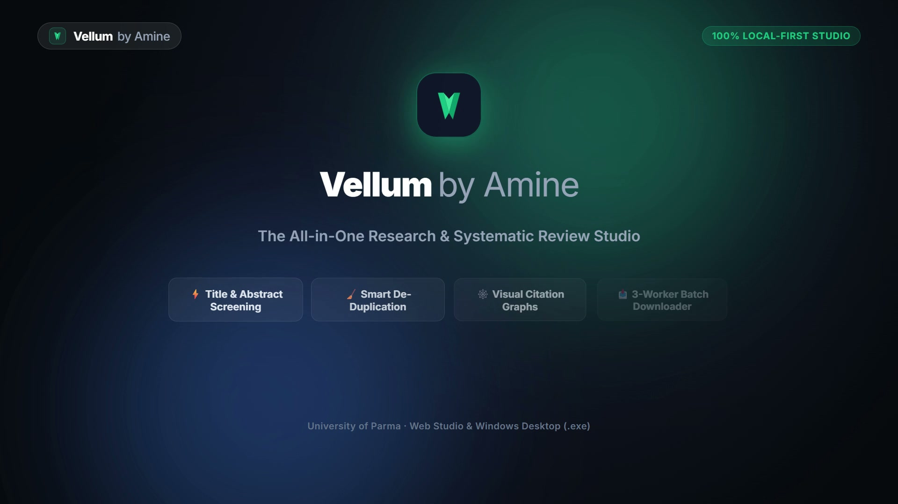

<p align="center">
  
  <h1 align="center">Vellum by Amine</h1>
  <p align="center">
    <strong>The 100% Local-First Academic Literature & Systematic Review Studio</strong><br/>
    <em>Zero subscription · Zero cloud tracking · Multi-source discovery across 250M+ papers</em>
  </p>
</p>

<p align="center">
  <a href="#-quick-download--installation-windows"></a>
  <a href="LICENSE"></a>
  <a href="#-testing--verification"></a>
  <a href="https://github.com/aminezghi/vellum/releases/tag/v2.1.0"></a>
</p>

---

## 🎬 Video Demonstration

[](demo/vellum-demo-horizontal.mp4)

> 🎥 **Watch the Demo:** A 24-second tour showcasing the Active-Learning Screening engine, Connected Papers citation networks, grounded evidence extraction, and high-speed batch PDF harvesting.
> - **16:9 Landscape Video:** [`demo/vellum-demo-horizontal.mp4`](demo/vellum-demo-horizontal.mp4)
> - **9:16 Vertical Video:** [`demo/vellum-demo-vertical.mp4`](demo/vellum-demo-vertical.mp4)

---

## 💡 The Story & Motivation Behind Vellum

> *"As a PhD student with a background in Computer Engineering, beginning my doctoral research journey quickly exposed me to the frustrating reality of modern systematic literature reviews.*
> 
> *I found myself completely lost and overwhelmed in a fragmented maze of commercial tools: paying steep annual subscriptions for Covidence and Rayyan just to screen titles and abstracts, paying another recurring fee for Connected Papers to explore citation trees, juggling separate reference managers, struggling with paywalled PDFs, and constantly losing control over where my notes and research bibliographies were stored.*
> 
> *Every tool demanded another cloud login, another recurring monthly charge, and another proprietary silo holding my research data hostage.*
> 
> *Coming from a computer engineering background, I asked a simple question: **Why can't all of this run in a single, high-performance, 100% local workbench on my own machine?***
> 
> *That question drove the creation of **Vellum by Amine**: a unified, local-first academic research platform that integrates multi-source search across 250M+ records, D3 citation networks, active-learning screening, multi-tier open-access PDF harvesting, and grounded claim extraction into an elegant, zero-subscription studio. Nothing leaves your workstation. Every note, PDF, and decision belongs entirely to you."*

### 👤 About the Author & Current Research
**Amine Zouaghi** is a Doctoral Researcher and **FutureData4EU Fellow** funded under the European Union’s **Marie Skłodowska-Curie Actions (MSCA COFUND / Horizon Europe)**, carrying out research affiliated with the **University of Parma** (Department of Engineering and Architecture / Food Project) and the **University of Bologna**. His research focuses on Big Data, AI, Computer Vision, and Digital Transition:

- 🏛️ **Doctoral Fellowship Profile:** [FutureData4EU MSCA Fellow — Amine Zouaghi](https://site.unibo.it/futuredata4eu/en/fellows/thematic-area-5-food-bioeconomy-natural-resources-agriculture-and-environment)
- 🎓 **Institutional Faculty Page:** [University of Parma Profile](https://personale.unipr.it/en/ugovdocenti/person/270639)
- 📖 **Google Scholar:** [Amine Zouaghi on Google Scholar](https://scholar.google.com/citations?user=KeVyb90AAAAJ&hl=en)
- 🔬 **ResearchGate:** [Amine Zouaghi on ResearchGate](https://www.researchgate.net/profile/Amine-Zouaghi)

---

## 🚀 Quick Download & Installation (Windows)

All compiled Windows executables and portable bundles are available under **[Releases (v2.1.0)](https://github.com/aminezghi/vellum/releases/latest)**:

### Option 1: Native Windows Installer (Recommended)
Download **[`Vellum-Desktop-V2.1-Setup-x64.exe`](https://github.com/aminezghi/vellum/releases/download/v2.1.0/Vellum-Desktop-V2.1-Setup-x64.exe)**:
- Standard Inno Setup installer for 64-bit Windows 10/11.
- Installs to `%LOCALAPPDATA%\Programs\Vellum Desktop` with Start Menu shortcut and clean uninstaller.
- **Requires no Python or dependency installation**.
- *Note:* Because the binary is self-published without a commercial code-signing certificate, Windows SmartScreen may prompt *"Windows protected your PC"*. Click **More info → Run anyway**.

### Option 2: Portable Standalone Desktop ZIP
Download **[`Vellum_Standalone_Windows_x64.zip`](https://github.com/aminezghi/vellum/releases/download/v2.1.0/Vellum_Standalone_Windows_x64.zip)**:
- Extract anywhere (e.g., `C:\Vellum`) and double-click `Vellum.exe`.
- Zero installation required; completely portable on USB drives.

### Option 3: Zero-Install Web Studio (Colleague Share Package)
Download **[`Vellum_Web_Fernly_OneClick_Package.zip`](https://github.com/aminezghi/vellum/releases/download/v2.1.0/Vellum_Web_Fernly_OneClick_Package.zip)**:
- Extract anywhere and double-click **`START_VELLUM_WEB.bat`**.
- Ships with a bundled, pre-verified portable Node.js runtime (`v24.22.1 LTS`).
- **No Node.js, no Python, and no administrator rights needed**. Automatically opens `http://localhost:3002`.
- Stop anytime with a double-click on `STOP_VELLUM_WEB.bat`.

---

## 🛠️ Running from Source

If you prefer building and running directly from the repository, clean 1-click root launchers are provided:

```powershell
# Launch Desktop Workbench (http://localhost:8501)
.\launch_desktop.bat

# Launch Web Studio (http://localhost:3002)
.\launch_web.bat

# Launch both applications together
.\launch_both.bat
```

---

## 📂 Streamlined Repository Layout

```
vellum/
├── Vellum_Desktop/              ← Desktop Workbench (Python 3.13 + Streamlit)
│   ├── launch_desktop_app.bat   ←   Run desktop app from source
│   ├── Desktop_App/             ←   Source code, modules, Pytest suite
│   └── README.md                ←   Desktop guide
├── Vellum_Web/                  ← Web Studio (Next.js 16 + React 19 + Tailwind CSS)
│   ├── launch_web_app.bat       ←   Run web studio from source
│   ├── Web_App/                 ←   Next.js source, components, API routes
│   └── README.md                ←   Web guide
├── brand-assets/                ← Official brand identity (The Folded Folio mark)
│   ├── vectors/                 ←   High-resolution SVGs (horizontal, stacked, mono)
│   ├── rasters/                 ←   Scale ladder transparent PNGs (16px to 1024px)
│   ├── web-icons/               ←   favicon.ico, apple-touch-icon, webmanifest
│   └── guidelines/              ←   Brand specifications and geometry rules
├── demo/                        ← Demonstration videos & visual walkthroughs
├── DISTRIBUTABLES/              ← SHA-256 manifests & offline packages
├── launch_desktop.bat           ← Quick root launcher: Desktop (:8501)
├── launch_web.bat               ← Quick root launcher: Web (:3002)
├── launch_both.bat              ← Quick root launcher: Both apps together
├── LICENSE                      ← MIT License
├── CONTRIBUTING.md              ← Contribution guidelines & test reproduction
└── README.md                    ← Main documentation
```

---

## 🌟 Key Capabilities

| Capability | Web Studio (`:3002`) | Desktop Workbench (`:8501`) |
| :--- | :---: | :---: |
| **Active-Learning Screening** | Interactive candidate cards, stopping curves, keyboard shortcuts | ASReview-style Bayesian ranking, PRISMA flowcharts |
| **Citation Exploration** | Interactive force graph with prior & derivative works | Litmaps-inspired graph with instant queueing |
| **Multi-Source Discovery** | OpenAlex 250M+ search, trending velocity feeds | OpenAlex, PubMed, arXiv, Crossref with complex Boolean expressions |
| **PDF Harvesting** | Client-side blob retrieval & Unpaywall resolution | High-speed multi-threaded batch download queue |
| **Evidence Extraction** | Tri-pane reader with grounded claim annotations | In-depth text extraction, OCR fallback, notes persistence |
| **Citation Export** | BibTeX, RIS, APA, CSV, JSON | BibTeX, RIS, CSV, PRISMA 2020 metrics |

---

## 🧪 Testing & Verification

Every component and distribution is strictly tested before release:

```powershell
# Comprehensive verification harness (33 tests, end-to-end relocation)
& "Vellum_Desktop\Desktop_App\.venv\Scripts\python.exe" tools\verify_release.py --skip-install

# Desktop Pytest Suite (240 tests)
& "Vellum_Desktop\Desktop_App\.venv\Scripts\python.exe" -m pytest "Vellum_Desktop\Desktop_App\tests"

# Web Studio Test Suite (64 unit & adversarial tests)
cd Vellum_Web\Web_App; npm test
```

See [`RELEASE_REPORT.md`](RELEASE_REPORT.md) for the latest execution report and [`BUILDING.md`](BUILDING.md) for build instructions.

---

## 🔐 Checksum Verification

Verify the integrity of downloaded binaries against [`DISTRIBUTABLES/SHA256SUMS.txt`](DISTRIBUTABLES/SHA256SUMS.txt):

```powershell
certutil -hashfile Vellum-Desktop-V2.1-Setup-x64.exe SHA256
```

---

## 🙏 Acknowledgments & Inspirations

Vellum was built on the shoulders of remarkable open-science projects, academic tools, and open-source software libraries:

- **Inspirations & Pioneers**:
  - **Rayyan** & **Covidence**: For pioneering web-based systematic review screening workflows.
  - **Connected Papers** & **Litmaps**: For inspiring interactive citation network visualization and co-citation discovery.
  - **ASReview LAB**: For pioneering machine-learning active-learning screening principles and stopping heuristics.
  - **The Open Science Community**: For tirelessly advocating for open-access literature and barrier-free scholarship.
- **Academic Data & Discovery APIs**:
  - **OpenAlex**: For providing open, cataloged access to 250M+ global scholarly works and citation graphs.
  - **Unpaywall**: For making legal, open-access full-text PDF resolution reliable worldwide.
  - **Crossref**, **NCBI PubMed / PubMed Central**, and **arXiv**: For robust bibliographic metadata and open preprint distribution.
- **Open-Source Foundations**:
  - **Web Studio**: [Next.js](https://nextjs.org/) (Vercel), [React](https://react.dev/), [Tailwind CSS](https://tailwindcss.com/), [Dexie.js](https://dexie.org/) (client-side IndexedDB reactive persistence), and [Lucide Icons](https://lucide.dev/).
  - **Desktop Workbench**: [Python](https://www.python.org/), [Streamlit](https://streamlit.io/), [PyMuPDF / pdfplumber](https://github.com/pymupdf/PyMuPDF), [PyInstaller](https://pyinstaller.org/), and [Inno Setup](https://jrsoftware.org/isinfo.php).
- **Design & Creative Frameworks**:
  - [HyperFrames](https://hyperframes.studio/): For deterministic, high-frame-rate programmatic demo rendering.
  - [Kaan Kiziltug's Logo Design Skill](https://github.com/kaankiziltug/logo-design-skill): For the mathematical geometry audit and production branding pipeline behind the **Folded Folio** identity.

---

## 🤝 Contributing & Community

Contributions are welcome! Please review [`CONTRIBUTING.md`](CONTRIBUTING.md) for development workflows, testing requirements, and coding conventions.

---

## 👤 Author & Lead Architect

**Amine Zouaghi**
- Doctoral Researcher & Lead Architect
- Affiliations: University of Parma & University of Bologna (FutureData4EU MSCA Fellow)
- Contact: `amine.zouaghi@unipr.it` · [LinkedIn](https://www.linkedin.com/in/zouaghi-amine/)

---

## 📄 License

This project is licensed under the [MIT License](LICENSE) — free and open-access for academic researchers worldwide.
